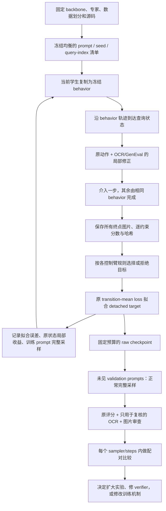

# 实验 pipeline：先判断修正，再检验训练后的完整模型

本文保留早期Phase2的流程和历史决策。Phase40之后的研究目标、完整实现缺口、评测与分阶段决策以[论文主计划](paper_plan.md)为准；不要把下文的“下一步”当作当前运行指令。

主线是外部专家的 OPD 蒸馏。当前不训练 Q critic，不做 self-distillation。
实际执行的第二阶段方案及预先固定的预算见 [PROTOCOL.md](../experiments/local_expert_v2/PROTOCOL.md)。

## 必须分开的四种证据

1. **专家能力**：原版 OPD/OPSD 复现有独立入口和协议；发布专家的单任务优势不等于它在复合 prompt 上整体更强。正式确认阶段应补全专家正常完整采样和 guidance-only 控制。
2. **局部动作价值**：同状态、同后缀下，专家介入是否有益、是否损害已有约束。用筛选器自己的评分算出的正增益有选择偏差。
3. **实际拟合效果**：接受目标的 MSE 是否下降；同状态单步介入是否改善；拒绝状态是否因共享参数发生漂移。这些仍是训练状态上的诊断。
4. **最终能力**：关闭专家和搜索，从初始噪声正常生成，在 validation/test 上比较。只有这一层能支持部署收益。

## 分阶段比较

| 阶段 | 需要回答的问题 | 对照和处理 |
|---|---|---|
| 已完成的 phase 1 | 是否存在局部机会；代码是否真的更新和恢复？ | 冻结 1920 图、native smoke、两轮训练、学习率的一步拟合检查 |
| 已完成的 phase 2 | 筛选、候选搜索和逐约束保护各自有无作用？ | 四臂各 12 更新及 960 张验证图；尚未显示稳定增益，见阶段记录 |
| 若 screen 有希望 | 收益是否只来自稀疏监督、时间位置、CFG 或更多计算？ | 随机接受率控制、固定早期策略、固定教师的步长控制、guidance-only、原版 OPD 计算匹配 |
| 确认阶段 | 是否跨 prompt、训练 seed、sampler/steps 成立？ | 更大数据、多个训练 seed、flow/DPM2 10/20/40、独立人工/可靠 verifier、锁定 test |

本轮刻意保留训练评分 v1，另做测量误差审查，避免同时换 reward 和选择算法。新增的 Tesseract 在生成图上漏读较多，**只能报告分歧，不能作为真值或新的训练老师**。

## 对“稳定增益”的要求

每一格都计算“训练模型 − 该 sampler/steps 下的相同 base/控制臂”。不跨格直接相减原始 reward，不在 test 选择 checkpoint，不把 raw 和 EMA 混比。一个训练 seed 的 prompt bootstrap 不能衡量训练随机性，也不能证明 bitwise 确定性。

如果收益只出现在训练网格，下一步是单独研究多网格/多后缀监督。若目标可拟合但完整策略不改善，则先查拒绝状态漂移、低噪声状态覆盖和局部改动累积；可在新阶段比较 rejected-noop 保持项，但不偷偷改变本轮的零损失拒绝规则。

第二阶段实际没有得到明确的训练网格收益，优先诊断拟合与全策略变化。保持项在 student=behavior 的第一次更新前梯度为零，单次更新后立即刷新 behavior 不能让它防止刚发生的漂移；下一实验需要在固定 behavior 下多次 fitting 或单独设计历史状态保持。详见 [结果后的下一设计](../experiments/local_expert_v2/NEXT.md)，尚未执行。

## 结果管理

- 每次尝试新建 `runs/` 目录，冻结源码、完整 config、数据、资产和查询清单；原 run 不覆盖。
- `experiments/local_expert_v*/` 保存预声明协议、run/job 映射、追加事件账本、结果摘要及证据链接。
- 出现 invalid scorer、缺失查询、损坏图像或协议不一致时停止正式比较，失败照样计入 GPU-hours。
- 原版 native baseline、机制对照、训练小样本检查和正式测试明确分开命名。
