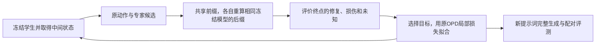

# 项目概览：我们在做什么，已经做到哪里

<!-- bounded-expert-preparation:start -->
**2026-10-11 15:11 EDT：Phase81完整诊断流程已准备并冻结，202输入、36项CPU检查通过，尚未提交GPU。** 固定强原生Phase77 EMA、64训练prompt、Flow40低噪声query，比较noop/full/bounded/等幅random；256端点和1280五质量，主比较bounded−random joint。教师临时加载后删除，所有学生后缀需精确noop回放；真实GPU验收仍待执行。不会把目标机会当学习成功。

四分区probe后，最早preempt预计明天02:04EDT，75分钟完整时限无法落在03:11EDT截止前；指定空闲ai-gpu21的test-only也未提前。因此未reserve、未提交，没有GPU失败或重复作业。预算仍20700/48600请求秒，余1作业名额；下一既有回调21:11UTC重新检查排队变化。零读图，确认/最终封存，Phase79/80效果结论未变。[冻结协议](../experiments/local_expert_v81/PROTOCOL.md) · [完整状态](../experiments/local_expert_v81_followup/SUMMARY.md)。
<!-- bounded-expert-preparation:end -->

<!-- phase80-current:start -->
**2026-10-11 11:11 EDT续看：Phase80完成并独立审计，尚未支持普遍梯度冲突解释。** Slurm1077779 COMPLETED0:0，实际765/请求4500 L40S秒；179冻结输入、三权重/潜变量哈希、192完整记录与汇总核对通过。三权重首状态GPU loss/梯度合同差均0。无训练、新图或新质量评分；确认/最终封存、agent读图0。

16训练prompt的64共同S0状态上，原生/两步EMA的full-vs-local梯度cosine为0.850/0.817，full-vs-no-Jacobian为0.963/0.962，均无反向状态。Jacobian并非零或必然无用；单状态方向也不等于Adam实际更新。两步模型j0首步误差16/16高于原生，j3为14/16，较晚j6/j8各10/16较低；总体loss接近。提示时间步拟合取舍，不能证明它导致dev损失。

下一候选是**保留首步监督的等权首步/两步loss**，检验endpoint-only是否牺牲局部拟合；先完成接口/梯度/预算检查，不盲目detach或加fit。候选仅草案、未提交，终端验证筛选仍未加入。Phase79仍为EMA joint50对原生49，区间跨0；RAW43对45及HPS下降保留，全五质量不删。

请求预算仍20700/48600秒，新增1/2作业，实际两作业合计15117秒，额度不退款；最多还可1项≤16200秒。本次未新增GPU。现有timer存活，下次17:11UTC（13:11EDT）。[独立审计](../experiments/local_expert_v80_followup/completion_20261011/SUMMARY.md)；[下一候选草案](../experiments/autonomy_20261011_2h/PREFIX_SUPERVISION_DRAFT.md)。
<!-- phase80-current:end -->

<!-- phase79-result:start -->
**2026-10-11：Phase79完整完成并独立审计，尚未证明超过原生OPD。** Slurm1077741 COMPLETED0:0，实际14352/16200 L40S秒；256真实更新、完整权重/EMA/来源/数据/LR/评分一致性检查通过，384新端点与1920主要质量齐全。确认/最终集封存，agent读图0。

主比较最终EMA：两步joint **50/128** 对原生 **49/128**，+0.78125pp，探索性配对95%区间[-7.8125,+8.6133]pp；16新增、15损失。OCR72→75，结构90→85，CER0.197563→0.179771，A_unknown30→24、B_unknown均0。家族joint颜色21→17、计数14→14、多重4→2、关系10→17；不挑关系类当总体成功。RAW43对45，HPS差区间全负，完整保留。

EMA五质量差：PickScore−0.000467、CLIP+0.002432、美学−0.001126、HPS−0.001527、ImageReward+0.006740，区间均跨0。训练epoch耗时1.875倍，额外教师查询/j9覆盖仍在，不能称算力匹配或效率优势。此轮测试两步学习组件，终端验证筛选尚未加入。学习到接近原生的能力，但方法超越仍待证实；也不能将区间跨0当作等效或idea无效。

下一步先诊断终点误差对局部误差的掩盖与梯度传播。独立梯度分解核心9项CPU检查通过，真实SD3接线/GPU验收未完成；拟定4500秒诊断尚未预留或提交。当前不盲目加fit/扫LR/挑seed；本次新增GPU0。全部报告、反证、统计限制与下一诊断见[完成报告](../experiments/local_expert_v79_followup/completion_20261011/SUMMARY.md)。
<!-- phase79-result:end -->

<!-- phase79-current:start -->
**2026-10-11 03:05 EDT：Phase78完整通过，Phase79完整学习比较已启动。** Phase78作业1077722 COMPLETED0:0，实际510/1800 L40S秒；8真实更新、EMA/导出差0、峰值37.079GiB、平均44.085秒/轮，首8轮prompt序列与Phase77相同。它是工程成功，未评任务收益。

Phase79作业**1077741**在preempt_gpu/ai-gpu21运行，单L40S协议，16200秒(4.5小时)硬上限，无requeue/自动重试/timer。四分区probe完成，sablab跨项目承诺2/6，本项目未占用其配额。预计训练11286秒＋评测约3194秒，另留启动余量，不保证如期结束。

从与Phase77相同纯底座/fresh LoRA开始，固定256更新、batch3、实际LR3e-4、密集anchor；使用Phase78已验收两步闭环目标。**主比较为新方法最终EMA−原生OPD最终EMA(49/128)，不是只比较初始底座。** 最终RAW诊断；384新图/1920主要五质量及完整joint/OCR/结构/CER/unknown，共同Flow40部署。重生成128 S0要求与Phase77图像/任务精确一致、质量差<=1e-4，全256轮prompt/LR日程核对。16项新增比较/评测检查通过，含真实旧评分与checkpoint。

两步增加教师查询/学生计算和j9覆盖，不能称同信息或同GPU算力对照。终端验证筛选尚未加入；本轮只测试新的学习组件。CLIP单项小降不自动阻止推进，所有质量/损伤仍完整报告，旧Phase77门槛不改。结果仍待完整训练/评测；确认512/final768封存、零agent读图。
<!-- phase79-current:end -->

<!-- phase78-current:start -->
**2026-10-11：Phase78 两步闭环目标已接入原生训练入口，1077722在preempt_gpu/ai-gpu21运行。** 单L40S、8更新、1800请求秒，无requeue/自动重试/timer。25项CPU检查通过；真实GPU microbatch1的一步退化输出/梯度差0、完整两步与重计算输出/梯度差0，前置验收已过；8次完整batch3训练/EMA/耗时验收仍进行中。源码与四分区probe已冻结，完成Phase77档案未改。

这是新方法的短轨迹学习组件：教师和学生从同一behavior状态各走两步，学生梯度穿过自己的中间状态，教师目标detach。按dt1/(dt1+dt2)缩放终点误差，保持常速度情形的原一步时间权重；第一步前向重计算节省显存。保留实际LR3e-4、密集9anchor/81例每更新、原生Adam/EMA。额外教师查询10→19/轨迹、学生计算增加且覆盖j9，不能称同算力/同信息对照。

用户接受CLIP单项小幅下降，不将其作为后续推进的自动否决条件；所有质量和损伤仍完整报告，不改Phase77旧门槛。Phase77 joint17→49是原生对照，**尚非我们的创新收益**。本轮不评dev或五质量，不证明超过OPD；通过后按实测成本冻结同起点256更新完整学习比较。终端验证筛选尚未加入，确认/最终集封存，agent读图0。
<!-- phase78-current:end -->

<!-- phase77-result:start -->
**2026-10-10：Phase77完整完成并审计，1077269 COMPLETED0:0，实际9225/10800 L40S秒。** 原生SOPD-GenEval从纯SD3.5M训练256次，20736状态、覆盖507/512训练prompt；最终EMA/RAW权重链通过，384同条件Flow40开发图和全部1920主要质量值齐全。2旧任务参考完全一致、40旧质量分数差0，零agent读图。

同128探索dev：S0/最终EMA/最终RAW joint **17/49/45**，OCR **73/72/70**，结构 **32/90/88**。预声明EMA−S0 joint **+25pp**，描述性95%区间[+14.84,+35.16]pp；新增44、损失12，其中9例OCR损失、3例结构损失。颜色/计数/关系主要提升，多重约束仅3→4/32。

EMA相对底座五质量：PickScore+0.000925、CLIP−0.005792、美学+0.152862、HPS+0.014832、ImageReward+0.349881；美学/HPS/ImageReward区间全正，PickScore与CLIP区间跨0。冻结“五质量均值都不降”条件未全过，不称无代价提升。RAW也有明显joint收益，不能挑RAW替代预声明EMA。

这是**原生对照真正学到收益**，尚未证明我们的创新方法超过OPD。不能把相对旧实验的改观唯一归因于训练量，原生实现/覆盖/EMA/采样等也不同。下一步同起点、实际LR、数据/更新预算匹配的两步闭环学习，先验收one-step退化一致性，另报额外计算；不同时加入筛选机制。确认/最终集继续封存，同128dev属探索性，无新GPU/timer。
<!-- phase77-result:end -->

<!-- phase77-current:start -->
**2026-10-09 23:05 EDT：Phase77 已提交并启动，作业1077269，minilab-gpu/ai-gpu12。** 单张L40S协议，训练加评测硬上限10800请求GPU秒；无自动重试/requeue/timer。四分区已probe；sablab现有跨项目分配2＋pending12，本项目未向其新增承诺，未改其他作业。

本轮建立原生任务适配SOPD-GenEval强对照：纯SD3.5M/fresh LoRA开始，官方batch3/27反向/81状态每更新，固定LR3e-4，256实际更新，共2304轨迹抽样/20736监督状态。保留官方loss、FP16和重复step EMA；最终256 EMA为主、RAW仅诊断。256是覆盖/预算选择，不是已收敛或论文规模复现。

训练后自动完整评估S0/最终EMA/最终RAW：相同128探索dev、相同噪声，统一Flow40/CFG4.5/text128/512px、FP32 CFG组合和单adapter，384新图；完整joint/OCR/结构/CER/unknown与五质量、配对区间。旧Flow10/published-student结果不替代新S0。2个既存任务参考要求证据完全一致，8个既存质量参考40值容差1e-4。新评测链10项CPU检查通过，含真实Phase76 EMA导出/状态检查差0；当前已核对3/256真实Adam更新、实际LR3e-4、每次81状态、实际L40S及共同初始哈希。256训练与完整评测尚待完成，**尚无本轮效果结果，也未测试创新方法**。

确认512/final768封存、零agent读图。下一项是与该原生对照匹配的固定两步闭环学习；若结构提升但OCR/joint下降，先分析专家任务取舍，不默认更多fit能解决。
<!-- phase77-current:end -->

<!-- phase76-result:start -->
**2026-10-09晚：Phase76官方完整训练循环通过，1077242 COMPLETED0:0，实际250/1800 L40S秒。** 从纯SD3.5M/fresh LoRA开始，官方batch3/每轮9轨迹81状态，完成8真实Adam更新、648监督状态，实际LR3e-4无跳步。见过59/512训练prompt；峰值显存36.83GiB，均值23.65秒/轮。原生step7三次EMA调用及最终checkpoint重放差0，RAW/EMA均已改变。20项CPU＋6项报告检查通过。

这是完整主循环/显存/吞吐验收，未评任务与五质量，不能当作方法提升或充分收敛。256更新配置与384图完整评测草案已写出；训练部分粗估101分钟，评分整合/总预算仍待冻结，256训练尚未提交。下一步进入足量原生任务适配OPD及匹配闭环学习；不再以本地数值必须逐位等价作为无期限前置条件。零agent读图，确认/最终集封存，无重试/timer。

[本轮结果与下一轮配置](../experiments/local_expert_v76_followup/SUMMARY.md)。
<!-- phase76-result:end -->

<!-- phase75-result:start -->
**2026-10-09：Phase75三路径消融完整完成并独立审计，1076817 COMPLETED0:0，实际250/1800 L40S秒。** 同27状态/教师目标/初始权重各1更新：仅修CFG为FP32后，相对官方梯度差0.9707%→0.7517%、整体参数更新差2.8247%→2.4732%；原梯度/参数门槛仍未过。目标差0，loss差缩至1.16e-10，RAW单adapter重放差0。共同部署单prompt/new-seed终点latent差3.43%→3.10%，不能据此推断图像质量或任务成败。171输入/5张量档案核对通过；无新图/任务/五质量结果。

结论是CFG修正部分缩小实现偏差，不能直接把数值门槛未过判成idea无效。下一步优先用官方入口建立足量任务适配OPD，再做匹配的固定两步闭环学习；不无限追求逐位一致。闭环数学核心9项CPU检查通过，尚未接入真实训练/GPU。确认/最终集封存，零读图，无新GPU/timer。

[结果、解释与后续](../experiments/local_expert_v75_execution_20261009/SUMMARY.md) · [下一学习比较](../experiments/local_expert_v75_execution_20261009/NEXT.md)。
<!-- phase75-result:end -->

<!-- phase74-result:start -->
**2026-10-09：Phase74真实SD3数值验收完成，梯度/Adam参数一致性门槛未通过。** 作业1076775 FAILED1:0，minilab-gpu/ai-gpu13实际L40S，308/1800秒。教师目标差0、loss最大差4.49e-8，但梯度全局相对差0.9707%（阈值0.1%）、Adam后参数最大差5.19e-4（阈值3e-6）；27状态/同起点各1更新及RAW单adapter导出重放完成，重放差0。由阈值主动停止，未自动重试。

已独立加入显式CFG组合精度选项，默认保留旧行为；31项相关CPU检查通过，尚未GPU验证修复是否足够。官方FP32输出后CFG与本地先CFG后FP32有已证实差异，但本轮不足以唯一归因全部更新偏差，也不证明此前质量退化根因。无新图或任务/五质量结果，确认/最终集封存。下一步同状态三臂精度消融，再做充分训练的任务适配OPD；短轨迹创新实验继续等待学习链验收。

[完整结果、账务、候选修复和下一步](../experiments/local_expert_v74_execution_20261009/SUMMARY.md)。以下为历史记录。
<!-- phase74-result:end -->

<!-- phase74-current:start -->
**2026-10-08：Phase74原生/本地学习路径验收已实现，25项CPU检查通过，真实GPU验收待资源。** 官方81状态/27次反向累积的CPU梯度最大差1.75e-10、Adam后参数差0。发现原生EMA在同global_step重复调用与本地每更新调用不同；另确认官方Accelerate先转FP32再组合CFG，而本地先组合再转FP32。二者都不能直接解释此前全部RAW退化。

原准备包遗漏原生AMP输出转换，已在提交前发现并独立准备修订包；本地算法和完成档案未改。四分区probe未找到协议规定一小时内可启动的L40S，GPU提交0；单次修订验收上限1800秒，无重试/timer。下一步先测真实SD3目标/梯度/Adam/导出重放，之后才冻结充分训练的任务适配OPD对照。短轨迹方法尚未实现，尚无超越OPD的新证据；零读图，confirmation/final封存。

[本轮发现、修订与资源状态](../experiments/local_expert_v74_followup/SUMMARY.md)。以下保留历史记录。
<!-- phase74-current:end -->

<!-- phase73-current:start -->
**2026-10-08：Phase73补评分完整结束，OCR局部机会门槛未通过，停止扩大当前路由。** 作业1074344 COMPLETED0:0，实际148/900 L40S秒；320主端点/1600五质量齐全，8旧参考40值最大差0，15项冻结CPU检查通过。原Phase72 FAILED档案保留；本次无生成、训练或任务重评，零读图。

固定64训练prompt，S0/GenEval局部/GenEval完整/OCR局部/OCR完整：joint **10/11/22/7/7**，OCR **27/28/32/35/53**，结构 **16/24/46/12/9**。OCR局部新增8例文字正确但只有1例同时joint成功；4例joint损失均为结构损失。独有修复1、净增−3，未达到原≥4/≥2门槛。

GenEval完整相对S0五质量及其描述性区间均为正；OCR局部四均值下降、CLIP升但区间均跨0；OCR完整五均值均降，其中美学/HPS/ImageReward区间全负。全部指标与区间已封存。这是训练cohort专家前向诊断，不是学生增益；GenEval完整CFG1与S0CFG4.5，不能将差异仅归因于权重。

下一优先项是验收完整OPD学习路径并建立足量、同任务/教师信息的强对照，查清教师能力为何未转为学生收益，再检验验证目标选择；不盲目加OCR或fit。尚未提交下一训练。确认512/final768封存，无新timer。**当前仍未证实我们的方法超越匹配OPD。**

[完整HTML](../experiments/local_expert_v73_cpu_report/report.html) · [解释与五质量](../experiments/local_expert_v73_followup/SUMMARY.md) · [下一步实施准备](../experiments/local_expert_v73_followup/NEXT.md)。以下保留前序带日期记录。
<!-- phase73-current:end -->

<!-- phase72-current:start -->
**2026-10-05：Phase72 作业1067893 FAILED 1:0，已完成独立 CPU 接口修复，五质量仍未完成。** 实际1084 L40S秒，原4500请求秒不退。本次未新增GPU、重试或timer，零读图，原失败目录/运行快照不改。

故障是新增endpoint漏写质量token audit需要的 `word`，不是模型训练失败。320端点和320任务评分齐全；128旧图摘要记录及完整A证据匹配，四adapter不变、0更新、预测次数符合计划。缺全部1600质量值，因此暂不判资格门槛或方法效果。此前21项合成测试未覆盖真实评分接口；现33项CPU测试通过，包含出错接口回归测试。已独立准备只添加冻结OCR目标字段的完整输入副本；GPU补评分尚未执行。

下一步只需复用现存生成结果补五质量，并按原门槛解释专家互补性，再决定学习协议。Phase71完整反例仍为base/all/veto/random joint9/5/3/4，尚未证实超越baseline。保留任务平衡OPD监督、用终端证据替换基准专家目标仍是假说；必须有相同专家信息的强匹配控制、充分训练与完整学生评估。确认512/final768封存。

[失败与修复核对](../experiments/local_expert_v72_cpu_repair/SUMMARY.md) · [独立补评草案，未提交](../experiments/local_expert_v72_cpu_repair/RECOVERY_PROTOCOL_DRAFT.md) · [研究反思](../experiments/research_reset_20261003/REFLECTION.md)。旧Phase72 status.json仅为当时启动记录，最新真实状态以此独立审计和sacct为准。
<!-- phase72-current:end -->

<!-- phase71-live-monitor:start -->
**2026-10-01 06:16 EDT：Phase71三臂完整结束，冻结门槛未通过，停止扩大当前veto配方。** all1066045/veto1066041/random1066093均COMPLETED0:0；最终16RAW、384新开发终点和1920五质量全部通过来源/权重/评分核对。相同128题，base/all/veto/random的joint为9/5/3/4，OCR54/11/8/5，结构28/65/68/69。veto−random joint −0.78125pp，描述性95%区间[-3.125,+1.5625]，未证实筛选优势。

veto相对random五质量为PickScore微降、CLIP/美学微升、HPS/ImageReward下降，HPS描述性区间全负；相对base/all四质量下降、仅美学提高。实际每臂16次同LR更新，veto/random各987目标，同任务/模板/时间数量严格匹配；1024名单决定仅30条不同，后续在线状态不配对。训练修复兑现本轮未测。旧native12/old_all13仅历史背景，不是本轮同日程或完整MOPD证明。

实际GPU17478 L40S秒（4.855小时）；请求预算32400/32400已满，未用时限不退，不再提交GPU。12小时窗口已于17:05:15 UTC（13:05:15 EDT）到期，原timer已退出，36次回调均有接收记录；没有后续唤醒或预算结转，不重复完成分析。完整报告与解释已封存；确认512/final768未用、agent读图0。下一问题是同当前起点的专家联合任务能力与局部互补性，现有草案未冻结/未提交，不能预设加专家或更多fit有效。

此前已完成[CPU来源与路径准备](../experiments/teacher_qualification_preparation_20261001/SUMMARY.md)：固定64训练病例/五路由，19来源SHA和7项新检查通过；识别旧诊断起点/队列不适配、未保存latent前缀及alpha=1计算路径差异。未进行新生成、训练或GPU验收，正式协议/权重链/评分集成仍待完成；不是新的正向结果。

[完整三臂HTML](../experiments/local_expert_v71_cpu_report/report.html) · [解释与全部CSV](../experiments/local_expert_v71_followup/SUMMARY.md) · [本次检查](../experiments/autonomy_20261001_12h/checkins/20261001T170515Z.md)。

**窗口已收尾，研究目标尚未实现。** [12小时总结与下一步](../experiments/autonomy_20261001_12h/CLOSEOUT.md)。本次仅核对账务/退出状态并整理交接，无新实验结果；零读图，完成档案未改。
<!-- phase71-live-monitor:end -->

**2026-10-01 02:32 EDT首批验收：** Phase71两组完成1/16轮。64初始状态、记录的128候选哈希及A证据跨臂完全一致；all学习64/64，veto只屏蔽5条已知损伤、学习59/64，含37条unknown弃权保留。实际LR均3e-4，各完成一次更新，评分技术错误0。新规则已在真实SD3首批按设计执行，完整训练/随机对照/开发任务与五质量仍待完成，不能当作学习增益。预算21600/32400未变，无新提交、零读图。 [首批数值核对](../experiments/local_expert_v71/runtime_audits/first_epoch.json)。

**2026-10-01 02:17 EDT：Phase71 已启动两组，尚无新效果结果。** 全部监督 all `1066045`、明确损伤屏蔽 veto `1066041` 均在 preempt_gpu/ai-gpu21 运行；各1×实际L40S、3小时硬上限，Requeue=0。287项输入指纹/共同配置/源码核对通过，两组fresh LoRA与禁用LoRA的初始输出逐位相同。每次提交前四分区probe完成：普通兼容分区预计等待超出窗口，sablab无兼容L40且跨项目承诺5/6；按已冻结中断即停止规则使用preempt_gpu。

本轮比较保留广覆盖OPD、只屏蔽已知损伤与全部监督/同量同时间随机屏蔽；unknown是验证器弃权，保留基础监督，不称安全。三臂同实际LR3e-4、1fit、16轮/64训练、最终RAW/128旧dev及全部任务与五质量。随机从共同纯底座开始，须待veto完整COMPLETED 0:0再提交。请求预算已预留21600/32400秒，余10800留给随机，失败不返还、不重试。旧Phase68 dev验证8/128、随机9/128的结论未改变；确认/最终集仍封存，agent读图0。

[当前作业与下一步](../experiments/local_expert_v71/STATUS.md) · [CPU前置核对](../experiments/local_expert_v71/cpu_preflight.json) · [活跃交接](../experiments/autonomy_20261001_12h/HANDOFF.md)。以下为带时间的历史记录。

**2026-10-01 02:04 EDT：三臂执行、审计和完整报告已实现，69项CPU检查通过。** 包含A证据/实际mask/LR重放、最终RAW核对、fresh随机、完整768终点/3840质量报告和一次性提交保护。旧base复用的6个生成/评分模块与Phase66 native/all快照完全一致。Phase71正在单一CPU进程214501中做完整资源指纹和输入冻结，尚未完成准备、未预留或提交GPU；不可重复启动。预算0/32400，零agent读图。

[执行实现与准备状态](../experiments/veto_execution_implementation_20261001/SUMMARY.md) · [冻结研究合同](../experiments/paired_veto_implementation_20261001/RESEARCH_PROTOCOL.md)。以下为前序记录。

**2026-10-01 01:41 EDT：成对时间日程＋明确损伤veto已接入共享训练引擎，125项CPU检查通过。** 新规则保留unknown并标记验证器弃权，只屏蔽确认true→false；随机匹配任务/模板/时间/数量并从共同初始输入重新训练。无损伤时与all的参数、Adam和EMA完全相同。真实1024查询形成512对，旧prompt顺序/noise不变；旧v2日程重算完全一致。三臂研究合同已独立固定，下一项补控制器与完整RAW/LR/A证据/任务/五质量报告，尚未GPU验收或提交。预算0/32400 L40S秒，零agent读图。

[实现与验收](../experiments/paired_veto_implementation_20261001/SUMMARY.md) · [三臂研究合同](../experiments/paired_veto_implementation_20261001/RESEARCH_PROTOCOL.md) · [执行待办](../experiments/paired_veto_implementation_20261001/NEXT.md)。以下为前序记录。

**01:22 EDT CPU续查：** 5120条训练A记录重放一致。Phase68验证状态中明确损伤56/1024；若仅屏蔽这些状态将保留968项，但大量仍unknown，不能声称安全。原日程按批次/任务/模板/时间匹配后，56个veto中51个没有替代选择，随机对照几乎相同；先设计有可交换候选的时间平衡日程，再决定独立协议。6项检查通过，无新GPU。 [分解与对照可行性](../experiments/selection_feasibility_20261001/SUMMARY.md)。

**2026-10-01 01:16 EDT：OPD原理审计发现监督覆盖与时间权重的额外差异，先研究再决定新训练。** Phase68两组均51/1024目标、35训练prompt且实际LR匹配，但验证44/51集中在索引0–3、索引7–8为0；随机对应35/51和6/51。原损失带Δt²，随机保留的系数总量是验证的2.2565倍。这不是梯度/Adam位移比例，也不是已证明根因。均匀单查询可无偏估计全时间平均目标；严格正例mask改变了监督支持和权重。更多fit只能检验兑现，不能补回缺失覆盖。5项数学边界CPU测试、14来源SHA及两臂统计重算通过，无新模型结果。

下一项先用冻结训练A记录分解明确损伤/收益/unknown及同任务同时间随机对照的可行性，再决定原4fit诊断或另立“保留OPD监督、只屏蔽已知损伤”的协议；不改旧门槛。Phase68完整dev仍验证8/128、随机9/128；Phase70直接教师修复明显但最终局部未兑现。论文仍缺强匹配OPD基线和稳定完整部署增益。

用户新授权的12小时窗口为**10月1日01:05–13:05 EDT，每20分钟续看**。本地同线程queue进程4026239运行，同线程接收测试已于05:18:28 UTC确认；非原生云定时。独立上限32400 L40S请求秒/4作业、每作业≤10800秒，目前预留0/提交0。本线无运行GPU；确认/最终集封存，agent读图0。

[原理、证据与新发现](../experiments/opd_foundations_20261001/SUMMARY.md) · [下一步可证伪问题](../experiments/opd_foundations_20261001/NEXT.md) · [12小时活跃交接](../experiments/autonomy_20261001_12h/HANDOFF.md)。以下带日期内容为历史记录。

**2026-09-30 22:45 EDT：多次拟合的记录与独立审计已实现，118项CPU测试通过。** 每个fit检查状态/目标固定，记录每步实际LR及整块前后真实权重，空批不更新；记录开关在Toy训练中不改变参数/Adam/EMA。Phase68的102个真实SD3保存状态、32个行为快照也通过CPU来源及张量接口检查。4fit块后模型明确命名post_fit_block，旧单fit审计保持原限制。下一轮研究合同已固定，尚需接入机制前向/完整报告并冻结执行输入，GPU尚未提交。本轮没有新的模型收益结果，agent读图0。

[实现与验收](../experiments/repeated_fit_implementation_20260930/SUMMARY.md) · [下一轮研究合同](../experiments/repeated_fit_implementation_20260930/LEARNING_PROTOCOL.md)。以下带日期段落为历史记录。

**2026-09-30 15:20 EDT：Phase70质量补评完整完成，瓶颈定位更明确。** Slurm1065386 COMPLETED 0:0，实际99/900 L40S秒；510主终点2550质量值补齐，8参考图40值与原记录完全一致。验证组自身51训练状态的joint为behavior1、teacher33、即时局部1、最终局部1、最终后缀2；直接教师的五质量改善区间均为正，但32个直接修复最终局部保留0。随机自身状态也有教师收益，因此这支持学习兑现不足，不证明筛选优势。Phase68完整开发仍验证8/128、随机9/128，门槛未通过。原Phase69 FAILED与夜间档案不改，零agent读图；当前无运行GPU或新timer。下一步先完成多次拟合独立权重审计，再冻结同实际LR、同量随机的1/4次fit比较，未提交新训练。

[完整机制HTML](../experiments/local_expert_v70_cpu_report/report.html) · [解释与全部差值](../experiments/local_expert_v70_followup/SUMMARY.md) · [下一比较草案](../experiments/local_expert_v70_followup/NEXT_PROTOCOL_DRAFT.md)。以下带日期段落为历史状态，质量缺失/未验收的旧描述已由本次独立补评更新。

**2026-09-30 09:00 EDT夜间收尾：8次续看全部接收，原timer已退出。** Phase68完整对照未建立筛选优势：同128dev验证/随机joint8/9，五质量均值相对纯底座提高，但冻结门槛未通过。Phase69在质量入口因cohort元数据遗漏技术失败，已完成任务部分显示验证组32个教师直接修复的即时/最终局部保留0，五质量仍0/2550。接口已CPU修复，几何与多次拟合准备已独立归档，尚无修复后GPU验收或新训练。本夜请求18900/23400、实际12547 L40S秒（含Phase68原作业全时长）；未使用额度不结转，失败未重试。目前无本线运行GPU/后续唤醒，零agent读图。研究目标尚未实现，下一步需补质量证据与新配置审计，再决定匹配学习比较。

[完整早晨交接（任务、五质量、预算与下一步）](../experiments/overnight_20260930/MORNING.md) · [已完成Phase68报告](../experiments/local_expert_v68_cpu_report/report.html) · [Phase69任务部分及失败边界](../experiments/local_expert_v69_cpu_failure_audit/SUMMARY.md)。以下为历史记录。

**2026-09-30 04:00 EDT续看：Phase68完整对照未建立筛选优势；Phase69技术失败，任务部分已独立审计。** Phase68验证/随机joint为8/9（同128dev），五质量均值相对初始提高，但冻结门槛未通过。Phase69 Slurm1065085因新增诊断遗漏cohort元数据，在质量评分入口FAILED 1:0，实际1296/4500 L40S秒；这是实现错误，不是算法失败。102状态、204原PNG精确重放、510任务结果齐全，五质量0/2550。验证组自身51训练状态的behavior/teacher/即时局部/最终局部/最终后缀joint为1/33/1/1/2；32个直接修复即时与最终局部均保留0，后缀保留1。目标loss下降但动作修正未充分兑现，仍非开发效果或质量保持证据。独立CPU修复与52项测试通过，原档案不改、GPU不重试。本夜请求18900/23400不变，剩余额度不自动使用；已有timer下一次05:00 EDT。

[Phase68完整结果](../experiments/local_expert_v68_cpu_report/report.html) · [Phase69任务部分/质量缺失](../experiments/local_expert_v69_cpu_failure_audit/SUMMARY.md) · [实现修复](../experiments/local_expert_v69_cpu_failure_audit/FIX.md) · [下一步未执行草案](../experiments/local_expert_v69_cpu_failure_audit/NEXT_PROTOCOL_DRAFT.md)。

下一步先补齐质量证据合同；未来有限拟合比较必须保留同实际LR和同量随机，并以完整部署joint与五质量判定。Phase54已证明局部修复恢复不保证胜过随机，不能只增加步数或追逐训练修复率。以下带时间记录为历史状态。

**2026-09-30 06:00 UTC续看：** random正常推进至8/16轮、30目标；前8轮两组监督分层数量、实际LR和更新序列完全匹配。验证51接受中，训练A标记33个joint修复（24prompt）、18个部分修复，44个集中在索引0–3；这是训练标签统计，尚非B评测或学习兑现。未产生新开发结果，未新增GPU，保留完整随机比较后再作诊断的顺序。[记录](../experiments/overnight_20260930/checkins/20260930T060000Z.md)。

**2026-09-30 05:19 UTC：Phase68验证组完成、随机运行。** 新验证joint8/128、OCR44/128，初始9/54；五质量均值与描述性区间相对初始均正，表现为质量恢复，尚未证明任务或筛选增益。旧验证joint1/OCR5；51接受/35训练prompt/16更新，真实权重链通过。新增接受状态分段诊断18项测试、合计40回归通过，未提交。用户新睡前授权：美东02–09点每小时续看；原GPU预算不变、额外最多2×4500秒，先冻结及预留，不自动重试，不读图。

[单臂完整证据](../experiments/local_expert_v68_verified_interim_20260930/SUMMARY.md) · [下一诊断](../experiments/accepted_state_diagnostic_design_20260930/README.md) · [夜间交接](../experiments/overnight_20260930/MORNING.md)。以下带日期段落为历史进展，当前状态以上述链接为准。

**2026-09-30 04:05 UTC：运行中完成CPU问题定位。** Phase68前三轮192查询/10个真实接受目标已核验，首轮128候选hash及A证据一致，loss复算与前两次真实参数位移吻合。另发现严格gate会拒绝“原项unknown、教师项已true且另有确认修复”的候选；离线区间规则使旧验证缓存接受22→55/1024，初始64候选的回放joint10→11，但这是受已暴露B启发的事后分析、不是学生学习结果，且仍仅5.4%监督。PickScore/Aesthetic相对严格回放略降也完整报告。4项新CPU测试含729组合穷举通过。当前规则/学习率/预算不改，没有新增GPU；下一项机制诊断应检查本轮实际接受状态上的教师→拟合动作→后缀收益。 [证据、反证与诊断路径](phase68_failure_diagnosis.md)。

**2026-09-29 23:45 EDT：Phase68匹配步幅诊断已提交。** verified1065020在scu-gpu运行，random1065024在preempt_gpu等afterok。两臂实际lr=3e-4×接受数/64，唯一算法变量；同纯底座、64训练、16轮、128旧dev和全部五质量，保存真实选中状态及参数步幅。121项CPU检查与155冻结输入核验通过。两个1×L40S作业各2小时上限，总请求14400 GPU秒，无自动重试/新定时器/agent读图。尚无新效果；稳定性恢复不等于筛选有效，confirmation/final封存。 [协议](../experiments/local_expert_v68/PROTOCOL.md) · [状态](../experiments/local_expert_v68/STATUS.md)。

**2026-09-30 UTC：完成OPD关系与失败设计审计。** 当前保留官方确定性局部loss，但已改成单查询＋严格正例mask，不能称完整原生OPD。验证仅22/1024目标；837含unknown（815涉及文字），156有确认修复且无已知损伤仍因unknown拒绝，原因可重叠。3072条三臂选择决策精确重放，99项CPU检查通过；未找到能独立解释退化的实现错误。稀疏步幅候选代码已实现测试，尚未冻结Phase68运行协议或提交GPU。旧续训/双adapter与当前纯底座/单adapter在论文计划中已分清。 [完整解释](opd_relationship_and_failure.md)。

**2026-09-29 23:00 EDT：Phase66/67全部完成并归档。** 纯底座/原生SOPD-GenEval/all/verified/random的128开发题joint为9/12/13/1/1，OCR为54/22/28/5/3。verified−random为0pp、描述性CI[-2.344,+2.344]pp；两稀疏臂均22目标/11更新且逐批计数一致，不能只归因于验证器。验证五质量相对初始CI全负；相对随机五项均值低、其中四项CI全负。当前严格筛选配置停止扩大。

Phase67同64初始训练状态：验证学生一步/接管后缀/全程joint为10→7→0、OCR28→18→4；全程相对后缀joint区间全负，后缀及前缀扩展各有四质量明确下降。目标MSE降低未转成完整生成收益。直接教师joint9对初始10，本批平均任务增益也未建立；2个直接B修复在两种学生局部动作中均未保留。训练状态诊断不能替代开发结果或全22历史目标兑现率。

两个作业均COMPLETED 0:0。640开发＋512机制终点、5760质量值齐全；128原PNG、128 A子句、16路由恒等检查通过，随机RAW/优化器/loss审计也通过。下一步优先隔离共享稀疏更新的稳定性，新的训练协议/预算尚未冻结或提交。原完成档案保持不变，确认/最终集封存，零agent读图。

[完整汇总HTML](../experiments/phase66_67_closeout_20260930/report.html) · [当前状态](../experiments/CURRENT.md) · [下一步边界](../experiments/phase66_67_closeout_20260930/NEXT.md)。

**19:24 EDT实测核对：** Phase67已在实际L40S通过64/64初始状态及128/128原PNG逐位重现，正在生成分段对照，尚无收益结果。Phase66随机完成12/16轮、9次更新，计数匹配继续通过。[为何这样诊断与解释边界](learning_gap_diagnostic.md)。

**2026-09-29 19:20 EDT：Phase67机制诊断已启动，Phase66随机对照继续。** 新作业1064833在preempt_gpu，独立1×L40S×75分钟上限，Requeue=0；被抢占或技术失败停止，不重试。普通分区预计次日，首次真实提交前单独记录调度调整；sablab实际占用5张，本轮未增加。38项CPU检查通过，零agent读图。Phase66 random1064749已完成11/16轮、8次更新，已完成轮次的数量/族/模板与验证参考逐项一致，最终结果尚未齐。

已知纯底座/原生SOPD-GenEval/全目标/验证的128开发题joint仍为9/12/13/1；严格筛选组五质量均下降，不能扩展这套配置。新诊断在共同初始64状态比较最终学生的“一步动作＋初始后缀”“一步动作＋最终后缀”“完整最终生成”，以区分动作迁移、后缀与前缀影响；不是新训练或有效性证明。仅初始状态能严格重建，不能冒称复测后来22个接受目标；第一批原A仅接受1个，base/teacher A joint为8/7。要求原128张PNG哈希一致及16个零前缀路由恒等检查。全512终点/2560五质量；确认/最终集封存。

[当前状态](../experiments/CURRENT.md) · [Phase67协议](../experiments/local_expert_v67/PROTOCOL.md)。

[论文主线与理论边界](paper_story_20260929.md)：研究整体强教师的局部监督是否值得信任；当前严格正例筛选、已观察局限和候选“明确损伤屏蔽”变体分开记录。新建议未改正在运行的Phase66，也没有新增GPU。

**2026-09-29 18:21 EDT：Phase66三臂完成，严格正例组明显退化，停止扩大。** 纯底座/原生SOPD-GenEval适配/全部局部目标/验证的开发joint为9/12/13/1（各128题），OCR为54/22/28/5、结构28/66/63/24。验证−原生joint为−8.594pp，95%区间[-14.063,-3.906]；验证五质量相对base/native/all区间全部为负，已违反冻结推进必要条件。random1064749已按依赖启动，仍用于区分筛选偏差与稀疏学习，尚无最终结果。验证仅22/1024目标、11更新；2048条训练A重放、RAW/训练权重一致性和loss归一化核查通过，21项CPU测试通过，暂未发现这些实现错误。下一步完成随机和四臂归因，不自动放宽gate或扩大训练；图像读取0、新GPU0。 [最新完整分项](../experiments/local_expert_v66_interim_20260929T2221Z/SUMMARY.md) · [检查与下一步](../experiments/phase66_followup_20260929/NEXT.md) · [CURRENT](../experiments/CURRENT.md)。

**历史定位：** [65轮回顾HTML](../presentations/2026-09-29_research_history_v1/index.html)将研究分为8阶段。v1–3纯底座小训练→局部拟合/泛化诊断→教师推理组合→GenEval教师G/S1学习→自动评测→官方Student续训→多池/质量取舍→共享引擎验收。正信号不应跨标签、起点和分母累加。框架与诊断已多次验证，稳定筛选增量和强原生主比较仍待实验证明。

**2026-09-29最新：Phase65已补齐24图任务和全部五质量，独立CPU审计完成。** 评分差异已在原两候选上复现：训练默认/仅工作区模式完整证据8/8一致，确定性模式4/8一致但语义8/8一致，差异仅教师检测置信度。新评分合同通过；8dev初始/验证/随机joint为2/2/3，OCR为5/3/5，验证五质量相对初始均升、相对随机2升3降，仅作两次更新的工程小测。Slurm1064725仍FAILED：全部评分完成后的缓存锁mtime检查报错；52资源SHA和243冻结输入复核不变，CPU恢复报告独立保存，无GPU重试。实际247/900 L40秒。已实现并测试64/512任务×模板均衡日程，规模训练未提交；39项CPU检查通过，确认/最终集封存。 [报告](../experiments/local_expert_v65_cpu_audit/report.html) · [审计](../experiments/local_expert_v65_cpu_audit/SUMMARY.md) · [规模设计](../experiments/scale_comparison_design_20260929/README.md)。

**2026-09-29 最新：Phase64两组训练已齐，评分一致性检查技术停止。** Slurm1064714 FAILED，实际290/1800 L40秒；原Phase63的185秒另计。随机臂完成2次更新，与验证臂逐批监督4/1一致、mask有6/32不同；首轮32候选图和A证据完全重放。24个共同开发终点已生成，但第一张训练候选A完整证据重评分不等，任务和五质量尚未计算，不能报告新效果。独立CPU补齐失败前取证和生成记录，19项检查通过，严格门槛未放宽。下一步仅诊断/评分旧图，不重训练或生成；当前无本线GPU或定时器，确认/最终集封存。[原记录](../experiments/local_expert_v64/SUMMARY.md) · [CPU审计与下一步](../experiments/local_expert_v64_cpu_parity_audit/SUMMARY.md)。

**2026-09-29下午更新：Phase62在线接口已验收，Phase63部分完成后技术停止。** `semantic_batch_v1`接入原engine，保留unknown/error并使用verified冻结的逐批分层数量匹配随机；105项CPU测试和历史192条决策重放通过。Phase63验证组两轮两次更新完成（接受4/16、1/16）；准备随机组时计算节点找不到git，Slurm1064571 FAILED，实际185/1800 L40秒，random和开发/五质量尚未运行。独立CPU修复改为克隆冻结输入，52项回归通过，真实随机目录已准备但未提交；没有重训verified或自动重提GPU。后续需补未执行的随机组与共同评测，不能报告新的效果增益。读图0，确认/最终集封存。

[在线接口](semantic_online.md) · [Phase62](../experiments/local_expert_v62/SUMMARY.md) · [Phase63原失败](../experiments/local_expert_v63/SUMMARY.md) · [执行修复与下一步](../experiments/local_expert_v63_cpu_execution_fix/SUMMARY.md)

**09:00夜间最终状态：已推进到Phase60，六次整点续看全部收到，定时器已自然退出。** Phase58三池候选joint74→84/192、五质量相对旧教师改善；Phase59/60两池学习的新验证/随机为57/53、52/50（共用128dev），选择增量区间均跨0。池2旧验证60→52，门槛失败，停止扩大CFG1；四项质量仍低于初始学生。真正专项收益存在，稳定筛选贡献/质量保持/强OPD对照/单adapter部署仍缺。全夜960新终点、4800对应质量，实际6228 L40秒；10800请求秒全部预留、余额不回收，未新增GPU。已封存夜间汇报，白天优先共同起点SOPD-GenEval适配和部署验收。[最终HTML](../experiments/overnight_20260929_closeout/report.html) · [交接](../experiments/overnight_20260929_closeout/SUMMARY.md) · [下一步](../experiments/overnight_20260929_closeout/NEXT.md)。

**08:00 CPU比较检查已完成：** Phase59/60池内验证−随机的共同起点、状态、实际训练量、评测和部署匹配；只差名单及选择方式，不能把当前不稳定收益归于这些比较条件不一致。跨CFG同时改了目标数/名单/分层和实际训练量，保留整套配置比较、拒绝“纯幅度/同算力”标签。6臂1152既有终点、5760质量绑定及22项CPU检查通过；没有新预测。部分任务大权重旧记录仅size/mtime，正式协议须补完整指纹；两adapter、推理成本未知仍明列。正式共同起点OPD对照缺预算/成本/数据选择/checkpoint等8项，保持draft_not_submittable。本夜不再新增GPU，Phase60停止结论不变。[简洁HTML](../experiments/comparison_contracts_20260929/report.html) · [检查范围](../experiments/comparison_contracts_20260929/SUMMARY.md) · [下一步](../experiments/comparison_contracts_20260929/NEXT.md)。

**07:00 CPU配方审计：** 官方MOPD和SOPD-GenEval默认每轮采新学生轨迹、监督前9步、lr3e-4并使用EMA；当前固定64状态、只训j=1、lr1e-4且专用路径不更新EMA。单项transition-mean loss及梯度一致，整体训练/部署协议不同。已有共同发布Student起点的512train/128dev原生适配预检查，但仅两epoch、未提交；短跑EMA不会更新，须单独核验raw权重。14项配方、35份源码/记录快照、17项CPU检查完成；没有新GPU结果或因果归因。[配方HTML](../experiments/opd_recipe_audit_20260929_report_fix/report.html) · [解释](../experiments/opd_recipe_audit_20260929_report_fix/SUMMARY.md) · [下一步比较合同](../experiments/opd_recipe_audit_20260929_report_fix/NEXT.md)。

**当前（2026-09-29 06:00续看）：Phase60已正常完成并审计，第二池未通过冻结推进门槛。** 同128dev，池1旧验证/随机57/63→CFG1的57/53；池2旧60/52→CFG1的52/50。新验证−随机分别+3.125/+1.5625pp，区间均跨0；池2验证相对旧配置−6.25pp，不能用相对随机的小正差掩盖。两池五质量相对旧验证点估计均改善，但相对初始学生仍有四项下降。池2接受修复仅兑现5/10；CPU动作诊断显示拒绝状态也明显向教师移动，MSE不足以解释全部终点成败。本夜停止扩大CFG1学习、不追加GPU；实际6228 L40秒，请求10800秒已全部预留。 [双池HTML](../experiments/local_expert_v60_followup/report.html) · [解释与审计](../experiments/local_expert_v60_followup/SUMMARY.md) · [下一步](../experiments/local_expert_v60_followup/NEXT.md)。

**2026-09-29新增CPU复盘：** 原冻结A选择规则在相同128已暴露dev直接执行为44/128，固定教师50/128、初始学生38/128；B事后两候选赢家62/128只是机会诊断。24个B修复中18个被拒且都含unknown，17个涉及文字。三池拒绝集合的30个A明确损伤与128个弃权/无明确损伤不可混成可靠noop标签。下一步拟以“损伤证据保持 vs 同量随机保持”区分选择信息与保持强度；未训练、未提交，详见[复盘](../experiments/research_reset_20260929/SUMMARY.md)和[协议草案](../experiments/research_reset_20260929/NEXT_PROTOCOL_DRAFT.md)。

更新：2026-09-29。这是工作区的持续更新概览，具体运行以[当前入口](../experiments/CURRENT.md)和各轮冻结档案为准。

## 一句话定位

我们研究：**外部专家虽然整体更强，但它在某个学生状态上给出的修正是否值得模仿？能否只学习经最终图像验证的有益修正，并让学生在新提示词上稳定提升？**

主任务是一张图同时满足文字、数量、颜色、关系等要求。主要结果是全部声明要求同时成立的比例，OCR/结构分项、原正确约束损伤、未知和五项通用质量指标一起报告。

当前主线是基于DiffusionOPD的外部专家蒸馏。冻结学生参与生成与补全，是为了对局部动作作配对比较；这里不使用OPSD的奖励梯度来构造自蒸馏目标，也不训练Q critic。旧CA-OPD、Q-Core/Q-OPSD代码保留在父目录；现在的研究引擎位于独立的`opd_lab`，不复制旧fork作为原生baseline。

## 最小方法与当前简化

以上闭环已有实现，但尚未产生稳定方法结论。当前Phase66–68从纯SD3.5-M＋fresh LoRA起步，最终评测物理上仅保留一个学生adapter并完成全部Flow10步；教师和verifier不参与部署。早先Phase50–60曾使用发布Student anchor与learner两个adapter、仅索引1调用learner，那是历史隔离诊断，不能混入当前完整学生结果。当前也尚未证明跨采样器鲁棒。

Phase55 masked训练仅对接受的教师动作回归，拒绝状态跳过loss；其158个拒绝训练状态joint为43→57，却贡献约79%的训练Aesthetic净下降。Phase57已独立实现完整选择目标，把拒绝状态的原动作也纳入监督。已审计的两个池拒绝动作漂移约降97%，四项质量回升，但接受目标拟合和开发joint下降；不再把“缺少fallback监督”视为足以解释全部问题的结论。该两池诊断不能冒称完整三池结果。

## 已实现与未完成

| 模块 | 已经实现／验证 | 仍未完成或限制 |
|---|---|---|
| 干净的上游baseline | 重新获取并固定OPD、OPSD公开源码；每个run独立快照；小规模训练、保存、重载评测跑通 | 未完成原论文完整数值复现。OPSD仓库README自称external implementation，不能混称作者原始实现 |
| 真实训练后端 | SD3.5-M、LoRA、明确的anchor/behavior/learner角色、原transition loss、Adam/scaler/RNG保存与恢复 | 早期主要为单训练seed；Phase55新增三个不同池/seed的本地控制run，仍缺原生强算法多seed对照；原生OPD入口resume与本地引擎须区分 |
| 配对局部介入 | 固定噪声与查询状态、共享前缀、候选到达状态上重新查询、冻结后缀、1/2步Flow介入 | DPM等有历史solver的训练分叉尚不能由Flow实现代替；支持DPM评测不代表分叉正确实现 |
| 自动目标选择 | 逐约束true/false/unknown、已确认修复、保护原正确项、未知弃权；全部教师、匹配随机、验证控制臂 | A/B评分器共享部分组件；未证明可靠的独立视觉真值或稳定筛选优势 |
| 训练和诊断 | 固定池受控拟合、各臂独立续训/刷新、LR和作用时间范围诊断、导出重载、轨迹和计数审计 | 一轮正信号未稳定延续，目标动作拟合不等于终点收益 |
| 评测 | OCR exact/CER、GenEval结构与联合成功、修复/损伤/未知、PickScore/CLIP/Aesthetic/HPS/ImageReward；配对prompt统计 | 自定义联合集分数不能冒称原始公开benchmark总分；质量不劣尚未证明 |
| 数据 | `paper_joint_v2`共1920条独立prompt：train512、dev128、confirmation512、final768；冻结噪声、组合与模板分工 | dev已使用；确认和最终集仍封存。程序化自定义集不能单独替代标准任务主表 |
| 管理与报告 | 配置/源码/权重/图像/评价器哈希、原始JSONL、费用、失败记录、HTML/CSV/SVG/PDF、不可变归档 | 工作区README曾停留在Phase20，本次已改成当前概览入口；早期文字另存，不改实验档案 |

本地核验的上游commit：OPD `0c85bf0193a6da24bb1f72152b612d353a154999`，OPSD `9c4c48cdfe5c3fa712d32957345d75fae9295696`，两个上游工作树当前干净。原生入口只作必要的运行生命周期/路径补丁，diff有记录；本地全部教师控制组不等于已完成正式recipe的原版OPD成绩。

## 最关键的实验证据

| 阶段 | 问题 | 已完成的结果 | 能说明什么 |
|---|---|---|---|
| Phase45 | 教师动作直接介入时，选择是否有价值？ | 旧分布192配对样本：原学生56，固定修正57，验证选择77；验证−固定+10.42pp，95%描述性区间[+5.21,+16.15] | 有限分布上的局部选择机会；没有训练学生 |
| Phase46 | 选出的动作能否学出首轮增益？ | 新64样本：初始18、全部目标28、随机20、验证30；验证−随机+15.63pp，[+4.69,+26.56] | 单训练seed、冻结池pilot出现正信号 |
| Phase47 | 继续刷新训练能否维持？ | 新32题上验证组自身更新前15，更新后12 | 正信号未稳定延续，不能声称在线收敛 |
| Phase50 | 一般质量是否保住？ | 200 DrawBench提示词×2噪声×5模型，2000张图，五项质量补齐；已观察到相对发布学生的质量退化 | 任务增益不能代替画质检查；统一Flow10协议不是原论文原生完整recipe |
| Phase51 | 限制learner的作用时间能否改善取舍？ | 128开发题：发布学生38、全程拟合56、限定时间57；时间条件策略相对全程质量更好，但相对发布学生仍有四项下降 | 部署时间范围值得控制；不证明筛选本身有效 |
| Phase52 | 共同起点、同时间策略下，验证是否超过随机？ | 全128开发题：发布学生38、直接教师50、全部目标52、随机42、验证43 | 验证−随机+0.78pp，[-5.47,+7.03]，筛选优势未成立；验证相对发布学生三项质量下降 |
| Phase53 | 学生在原训练状态上是否兑现选择？ | 已补完：原14、直接随机16、直接验证18、拟合随机16、拟合验证15（均/64） | 验证接受7个中的4个直接联合修复保留0/4；拒绝57个净+1，优先检查接受动作兑现 |
| Phase54 | 固定延长拟合能否保住修复并改善开发表现？ | 训练随机21/64、验证22/64；开发随机55/128、验证44/128，验证−随机−8.59pp，[-15.63,−1.56] | 原4个直接修复保留3/4，训练兑现改善；筛选泛化仍失败，验证相对发布学生四项质量下降 |
| Phase55 | 换三个独立训练池后，筛选增量稳定吗？ | 三池随机63/52/56、验证57/60/59（各/128）；平均主差+1.302pp，[−7.552,+9.635]；训练直接修复保留24/30 | 三池相对发布学生均提升，但验证相对随机不稳定；四项质量低于发布学生，确认门槛未达到 |
| Phase56 | 固定半幅能否保住全幅的任务收益并改善质量？ | 已暴露训练192状态：原学生43、单查询全幅74、半幅69；half−full −2.604pp，[−9.896,+4.688]；五项质量相对全幅区间均>0 | 未通过joint点估计不降门槛，停止这次幅度搜索；无训练，不是新学生有效性结果 |
| Phase57 | 把拒绝状态的原动作纳入监督能同时保住任务和质量吗？ | 两池验证masked→full为57→39、60→43（各/128），主差−14.06/−13.28pp、区间均负；四项质量恢复，CLIP区间跨0 | 漂移约降97%，修复兑现15/21→12/21；第三池未提交，必要门槛已失败，不自动扩展 |

这些阶段的数据、模型历史和分母不同，不能横向拼接成单条“持续上涨”的曲线。所有区间都需要结合各轮冻结协议理解；Phase55已有三个不同训练池/seed的探索性跨run区间，但仅三个run且共用已暴露的128题，仍不是独立确认。

## 当前卡点与下一步

Phase57完整目标 `a*=m*a_teacher+(1-m)*a_anchor` 已运行两个预定池。固定全幅、原mask、起点及16次更新，随机/验证同步改动，旧masked控制只读复用。两池主差verified full−verified masked分别−14.0625pp [−22.6563,−6.2500]、−13.2813pp [−22.6563,−3.9063]；verified full−random full为+1.5625/+3.1250pp、区间均跨0。四项一般质量恢复、CLIP点估计下降且区间跨0；相对初始学生仍有质量损失。两个GPU均COMPLETED，管理器CPU读文件失败；第二池在独立CPU记录收尾，第三池未提交。每次反向64相对旧12/11/11，不能称同算力。实际6802 L40秒、768新图/3840质量值，确认/最终集未用。详见[两池部分报告](../experiments/local_expert_v57_cpu_recovery/report.html)和[失败与结果审计](../experiments/local_expert_v57_followup/SUMMARY.md)。按冻结规则，每池主差非负的必要条件已失败，不自动进入下一轮。

Phase52在64个训练状态上接受7个目标。Phase53补全训练内终点时发现，原4个教师直接联合修复全未保留。Phase54将随机与验证都从4次延长到预定16次：验证接受目标MSE3.149→0.766，接受子集联合成功0/7→4/7，其中原修复保留3/4。拒绝57个联合成功14→18。于是“局部目标无法学到”不再是唯一解释。

但开发结果是验证44/128、随机55/128，主差−8.594pp，描述性95%区间[−15.625,−1.563]；验证相对原学生的净任务增益也不确定。PickScore、Aesthetic、HPS、ImageReward相对发布学生均下降，CLIP提高。验证在PickScore/HPS上优于随机，是取舍，不能替换预声明joint主指标。

[Phase55三训练池复制](../experiments/local_expert_v55/report.html)已全部完成。发布学生38/128；三池随机63/52/56，验证57/60/59。验证−随机平均+1.3021pp，探索性95%区间[−7.5521,+9.6354]，按冻结规则属于不稳定/不确定。验证相对发布学生平均+16.1458pp，随机也有+14.8438pp，因此不能把相对起点的增益全归因于选择。三池采用共同起点、相同16次拟合；共享128开发题，不能合并成384个独立prompt。

训练原直接修复分别保留7/11、8/10、9/9，共24/30；验证拒绝158个状态原43→57。两种拟合策略全训练joint均81/192。当前问题不再主要是完全学不到，而是选择的局部收益未形成稳定的额外泛化，并伴随一般质量下降。验证相对发布学生的PickScore、Aesthetic、HPS、ImageReward跨池区间全为负；CLIP跨0。验证相对随机全部五项区间跨0，不能声称不劣。

[CPU事后目标诊断](../experiments/local_expert_v55_followup/SUMMARY.md)发现34个被接受的教师目标中，只有5个在五项质量分数上均不下降。候选本身已存在质量代价，但该计数不是视觉真值或正式不劣检验。[Phase56](../experiments/local_expert_v56_cpu_report_completion/report.html)已完成固定半幅候选比较：192状态中half−full joint −2.604pp，描述性95%区间[−9.896,+4.688]；五项质量差均为正且区间下界>0，然而没有满足预声明的joint点估计不降门槛。停止这次幅度搜索，不训练半幅、不自动尝试其他alpha。区间跨0不等于已证明任务不劣，也不等于已证明任务下降。

原验证接受34题中全幅联合成功30、半幅20；全192题原全幅修复51个，半幅保留29个、另修复11个，原正确状态的损伤20→14。减小动作确实改善了自动质量分数，也削弱了部分原有效修复。半幅相对原学生的PickScore/Aesthetic/HPS仍下降，不能称为质量保持。192图/960质量值，Slurm1064082 COMPLETED、992/1800 L40秒；旧40个质量值重评最大差0。全程无训练、无新开发/确认/最终集，回调没有新GPU预算。

[同队列质量分解](../experiments/local_expert_v56/QUALITY_DIAGNOSIS.md)更具体地区分了两层问题：全幅局部教师、理想选择策略、拟合后学生的训练Aesthetic差分别−0.523、−0.077、−0.382；拒绝158状态约贡献79%的净下降。拒绝状态joint仍从43→57，说明不能用joint净增排除质量漂移。当前masked loss只跳过拒绝样本，并未蒸馏选择器的原动作fallback。该假设已在Phase57两个池检验：拒绝动作漂移降低96.71%/96.89%，接受教师MSE升到2.18/2.29倍，直接修复兑现15/21→12/21；拒绝joint由41/105降至33/105（初始28/105）。保持确实生效，也移除了部分任务收益。共享参数下的保持/修正取舍是解释性推断，尚未测得梯度冲突；不能自动追加权重搜索或声称完整idea不可能。

原Phase56归档508个文件与ZIP哈希核验通过。审计发现原报告缺少domain分组与任务分项差值区间，已在[独立CPU补充](../experiments/local_expert_v56_cpu_report_completion/AMENDMENT.md)中补齐；原18个主/质量区间复算一致，新增27个分项区间，主指标和决策不变。

三作业1063760/1063803/1063823均COMPLETED，共7867/16200 L40秒；1536新图、7680质量值。CPU独立重算45组跨池区间、核对1044个报告数字绑定及所有归档哈希。完成回调已接收，周期定时器在首次计划唤醒前自动停止，周期唤醒0次。
执行上，Phase54 GPU作业TIMEOUT，实际2419/2400秒；384图、384任务评分和1920质量值全部落盘，缺少顶层完成记录。独立CPU用约117秒补齐完整审计和报告，新增GPU0；原失败档案不改写。图像不进入助手上下文。

论文还有三类关键缺口：稳定的C2学习增益与质量取舍；同算力、共同起点的原生OPD/DanceOPD/NFT强对照及这些算法的多seed比较；标准GenEval/OCR、独立确认、跨Flow/DPM和步数矩阵。当前工程完成度已足够开展这些研究，但证据还不足以支持完整论文主张。

## 主要入口

- [当前实验状态](../experiments/CURRENT.md)、[论文计划](paper_plan.md)。
- [Phase57两池部分报告](../experiments/local_expert_v57_cpu_recovery/report.html)、[审计与解释](../experiments/local_expert_v57_followup/SUMMARY.md)、[下一步边界](../experiments/local_expert_v57_followup/NEXT.md)。
- [Phase56完整数值补充报告](../experiments/local_expert_v56_cpu_report_completion/report.html)、[审计与解释](../experiments/local_expert_v56_followup/SUMMARY.md)、[下一步边界](../experiments/local_expert_v56_followup/NEXT.md)。
- [Phase55完整报告](../experiments/local_expert_v55/report.html)、[审计与解释](../experiments/local_expert_v55_followup/SUMMARY.md)、[历史半幅草案（已落实Phase56）](../experiments/local_expert_v55_followup/NEXT.md)。
- [汇报材料库](../presentations/index.html)：10页主线、7页附录、离线HTML/PDF/ZIP及可复用图表与来源，封存快照不随后台变化。
- [已停止的夜间续看记录](../experiments/overnight_20260928_v2/STATUS.md)、[Phase56质量分解](../experiments/local_expert_v56/QUALITY_DIAGNOSIS.md)。
- [Phase52完整结果](../experiments/local_expert_v52/report.html)、[五组图片离线并排对比](../experiments/local_expert_v52_followup/visual_preview.html)。
- [Phase54完整报告](../experiments/local_expert_v54_cpu_recovery/report.html)、[判读](../experiments/local_expert_v54_followup/SUMMARY.md)、[下一轮计划](../experiments/local_expert_v54_followup/NEXT.md)。
- [Phase53完整报告](../experiments/local_expert_v53_resume/report.html)。
- [方法定义](method.md)、[时间条件策略说明](temporal_method.md)、[原生入口与使用说明](../README.md)。

默认助手直接读图0次；主证据来自冻结的本地自动评价、完整样本、数值与哈希审计。人工rating只用于辅助理解和发现具体错误，不是主实验决策的唯一依据。费用按独立实验账本记录，失败计费；任何几轮预算合计都不能冒称整个项目历史成本。
