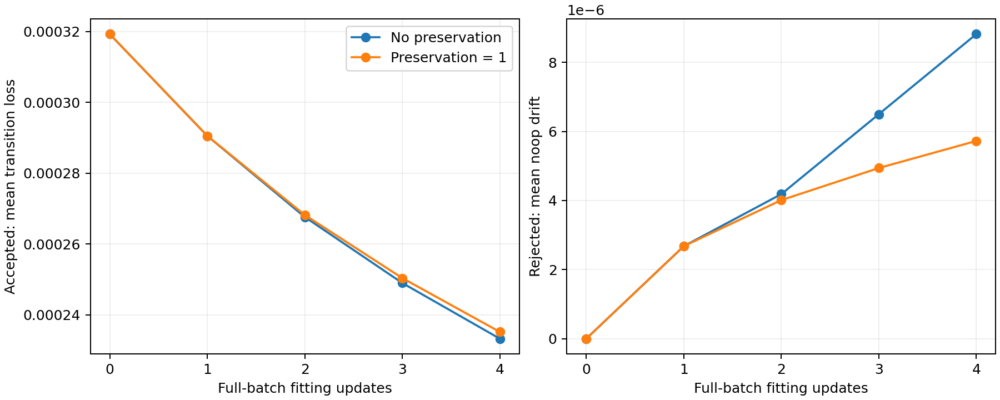
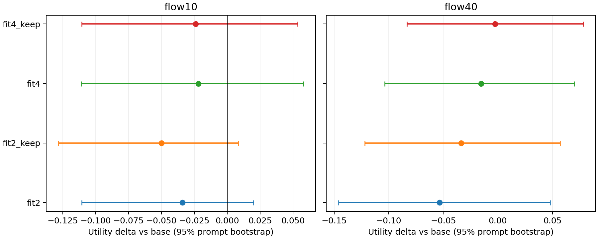

# 第三阶段完成：冻结查询的拟合与拒绝点保持诊断

2026-09-11 完成。**保持项确实减少局部预测偏移，但本轮没有得到稳定的普通生成增益。更多拟合也没有单调提高已接受修正的终点收益。**

主线仍是外部专家 OPD，拒绝点回归只是保持正则。此次是固定 64 个训练查询的机制诊断；每次更新按全部 64 个查询归一化，使用共同首步后分叉，不是完整 on-policy 有效性主实验。

## 预声明设计与完成范围

- SD3.5-M、新 LoRA rank32/alpha64，512/fp16、flow10；LR 3e-5、seed42；OCR/GenEval 外部专家、loss 和 v1 筛选规则延续上一阶段。
- 固定一次收集的 64 个查询、320 个候选，22 个接受、42 个拒绝。四个 checkpoint：fit2、fit2_keep、fit4、fit4_keep，保持系数 0/1。
- 首次更新只计算一次并保存 student/Adam/GradScaler/RNG；两个分支从相同状态出发，共执行 7 次实际更新。behavior 全程冻结。
- 每个 checkpoint 保存同查询单步介入和完整 flow10 生成：512 张训练后图片。普通评价是 base+四个 raw、32 validation prompts、seed42、flow10/flow40：320 张图。
- 40 张预选训练图片完成隐藏身份/分数的实施者审查。test 未使用。

## 实际结果

被选择的专家目标，在接受子集上的 v1 局部收益均值是 +0.520656；学生实际兑现的收益明显较小：

| 版本 | 接受目标 loss / 初始值 | 接受点单步 ΔU | 全部训练查询完整生成 ΔU |
|---|---:|---:|---:|
| fit2 | 0.838226 | +0.145509 | +0.059091 |
| fit2_keep | 0.839995 | +0.143236 | +0.047837 |
| fit4 | 0.730604 | +0.053042 | +0.050748 |
| fit4_keep | 0.736591 | +0.053232 | +0.049186 |

四次拟合时，保持项将拒绝点平均 transition MSE 从 8.8204e-6 降至 5.7267e-6（减少 **35.1%**），41/42 个拒绝点的偏移下降；接受目标 loss 仅比无保持项高约 0.8%。但两者的拒绝点完整生成都仍有 **5 个查询丢失已有约束**，涉及的查询并不完全相同。拒绝子集完整生成 ΔU 从 −0.004620 变为 −0.016922。

从两次到四次拟合，每个分支都有 20/22 个接受点的目标 loss 下降，其中 **8 个点的单步终点收益反而下降**。事后三范数分解显示，四次拟合实现的目标方向投影约为 20%，平均余弦约 0.548；这是描述性分析，不能证明收益损失只来自幅度不足或方向偏移。

普通验证集相对同配置 backbone 的 ΔU：

| 版本 | flow10 | flow40 |
|---|---:|---:|
| fit2 | -0.034148 | -0.053600 |
| fit2_keep | -0.049885 | -0.033665 |
| fit4 | -0.021970 | -0.015477 |
| fit4_keep | -0.023872 | -0.002469 |

**八项方法相对 base 的均值均为负，95% prompt bootstrap 区间均包含 0，未显示稳定增益。** 保持项相对无保持项的均值在 flow10 为负、flow40 为正，也没有稳定的跨配置优势。完整 CI、joint success、分项约束和预声明的全部对照见完整报告。

这里只使用一个训练 seed 和 32 个验证 prompt；区间不包含训练 seed 变异，未作多重比较校正。固定全批拟合与第二阶段的 on-policy 批次条件不同，不直接把两个阶段的数值差当作因果效果。原始 OPD/OPSD 的论文数值复现进度另见框架 README。

## 测量覆盖与解释

匿名图像审查发现：五幅绿色椅子图都被截断，但 v1 joint 全部通过；fit4_keep 的一幅书本图存在额外叠书及裁切，却被计数器判为满足。v1 只覆盖已编码子约束，不能代表完整提示词满足。文字间距、裁切也会造成视觉可读但 OCR 不通过。

观察者是实施者，不是独立真值。香蕉图存在“一根剥皮香蕉/两根香蕉”的解释歧义：保留原始盲审，另存揭示身份后的敏感性说明，不将其作为已确认的检测错误。未修改任何训练/评价标签，详见 [审查说明](review_report.md)。

因此本轮支持局部保持机制有效，并揭示了拟合距离、终点代理收益与普通生成之间的不一致；尚不能据此判定整个方法无效，也不能宣布稳定增益。下一步先检查测量与动作方向/幅度的可兑现性，详见 [未执行的后续方案](NEXT.md)。

## 工程、成本与证据

- 训练作业 1047916 与评价作业 1047917 均成功；总计 **0.766944 L40S GPU-hours**，包含模型加载和全部诊断。两分支各 192 backward queries、4872 forward examples、256 verifier images，边际计算相同；所有运行合计 448 backward queries、13920 forward examples。不是 native 训练效率比较。
- 45 项 CPU 测试通过；真实 tiny SD3/PEFT 冻结 behavior、完整 Adam/RNG 分叉以及四 checkpoint 的 toy 全链路通过。真实 GPU 四份 raw 导出与完整 student 状态逐张量哈希一致，Adam 步数为 2/4。
- 汇总器验证全部 1152 张保存图像、共同首步和冻结 behavior。两种 flow 配置各 32 张 backbone 图片与第二阶段重生成逐张哈希一致；这是工程一致性检查，不是新增独立样本。
- 审查汇总的“两条约束”假设被断言拦截后，改为按冻结数据映射全部 GenEval 子约束；仅修改分析程序，未产生错误的已发布统计，也未重跑或修改 GPU 结果。事件保留在 ledger。

- [完整数据报告](../../runs/le3_report_001/report.md)
- [机器可读结果](results.json) · [预声明方案](PROTOCOL.md) · [事件记录](ledger.jsonl) · [运行手册](../../docs/phase3_runbook.md)
- 训练：`runs/le3_probe_001`；评价：`runs/le3_eval_001`；图像审查：`runs/le3_review_001`。
- `report_index.json` 固定源文件、结果及审查记录的哈希。
